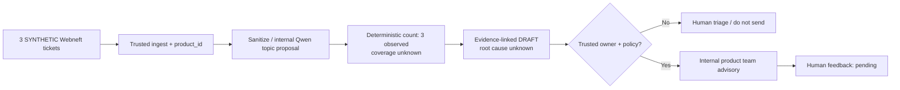

# Gazprom Neft multi-product AI Agent — synthetic end-to-end demonstration

**Status: demonstrative storyboard, NOT a real ticket analysis, model run, product decision, or confirmed incident.** Normative source: official PDF `Кейс_Искусственный интеллект.pdf`, p.2 (multiple products, recurring noncritical requests), p.4 (internal Qwen and source), p.6 (Webneft ticket #5, queue booking symptom). Webneft is only **one example product**, not the whole target system.

## Distinguish source facts from synthetic demo

**Provided example #5 (PDF p.6):** a user describes inability to book an electronic queue, sometimes seeing HTTP 404 or a message that time doesn't exist. **Only one narrative**; no real ticket ID, timestamps, source completeness, root cause, or recurrence label in PDF.

**Synthetic additions below are invented only to show how the proposed system would behave, not evidence of Gazprom Neft traffic:**

| Fake ticket key | Sanitized synthetic report | Distinct source identity | Label |
|---|---|---|---|
| `SYN-QUEUE-001` | «Не могу оформить бронирование: вижу ошибку 404» | one fabricated ticket | SYNTHETIC |
| `SYN-QUEUE-002` | «При выборе времени сервис сообщает: такого времени нет» | one fabricated ticket | SYNTHETIC |
| `SYN-QUEUE-003` | «Не удаётся выбрать слот электронной очереди» | one fabricated ticket | SYNTHETIC |

These are **three hypothetical separate tickets**, intentionally inspired by the **subject matter** of PDF #5, **not three original PDF tickets**. The similarity is at the booking-journey level; identical technical root cause is unknown. No recorded company observation time exists.

## Proposed E2E sequence

1. **Input and rights:** backend reads synthetic ticket records from the hypothetical adapter; assigns `scope_id + product_id=webneft`, timestamps at actual observation in a real implementation, and `taxonomy_version` from the configured product registry. In the demo all three records and any clocks would be artificial.
2. **Content:** internal Qwen-ASR/VL would process authorized media if it existed; no actual audio/image is present in this synthetic story. Text is sanitized and access-checked before internal text Qwen.
3. **LLM semantic proposal:** local Qwen **would propose**, with one allowed Webneft taxonomy: `business_journey=electronic_queue_booking`, `request_intent=bug_report`, `symptom_code=booking_404_or_slot_missing` or a justified `unknown`. It cannot prove common defect, calculate counts, or invent product owner/team.
4. **Trusted aggregation:** deterministic service counts `distinct(source_system,source_ticket_id) = 3` **in this synthetic observed set only**. `source_coverage=unknown_coverage`; no claim of 3 actual Webneft tickets, a rise in frequency or a complete population count.
5. **Business output (DRAFT only):** the below `ProductInsight` is an advisory artifact the team might receive **after internal policy approval and authoritative routing**. We do not claim it was delivered.
6. **Product team:** reviewer can mark accepted / rejected / needs_info; here `feedback_status=pending`, not an invented team decision. No ticket status or business order changed.

## Demonstrative product-team insight (not a real LLM response)

```json
{
  "schema_version": "product-insight-demonstration-v1",
  "synthetic": true,
  "scope": "demo-only",
  "product_id": "webneft",
  "headline_ru": "Затруднения с бронированием электронной очереди",
  "business_journey": "electronic_queue_booking",
  "observed_unique_ticket_count": 3,
  "coverage_status": "unknown_coverage",
  "evidence_refs": ["SYN-QUEUE-001", "SYN-QUEUE-002", "SYN-QUEUE-003"],
  "relation_status": "related_topic_unverified",
  "root_cause_status": "unknown",
  "trend_status": "not_assessable",
  "recommended_action_ru": "Проверить пользовательский путь бронирования и воспроизводимость сообщений об ошибке",
  "route_status": "requires_trusted_product_team_registry",
  "delivery_status": "draft_not_sent",
  "feedback_status": "pending"
}
```

The example is a **business-output display contract**, not a new official system/API contract. For actual deployment, only fields allowed by the signed product-specific schema and policy would be delivered.

### Mermaid — editable process illustration



## Jury defense talking points (RU)

- «Мы анализируем обращения **всех доступных цифровых продуктов**, а не только Вебнефти. Вебнефть — один набор примеров из условия.»
- «Три обращения на этом слайде **синтетические**; в PDF приведён **только один** пример об электронной очереди, а не измеренная статистика повторений.»
- «Qwen предлагает тематику, но число уникальных тикетов, права, полноту источника, маршрут и отправку проверяют детерминированные инструменты.»
- «Пока неизвестно, полны ли данные, можно сообщать только число **наблюдённых** запросов с оговоркой, но нельзя заявлять рост или общую первопричину.»
- «Product team получает **проект** конкретного полезного сигнала, а не автоматически заведённый баг, и решает, что с ним делать. Feedback улучшает оценку качества.»

**Acceptance:** slide output is visually legible at 16:9, says SYNTHETIC conspicuously, counts 3 invented IDs, no actual corporate use, no owner invented, no assumed root cause or real growth.
