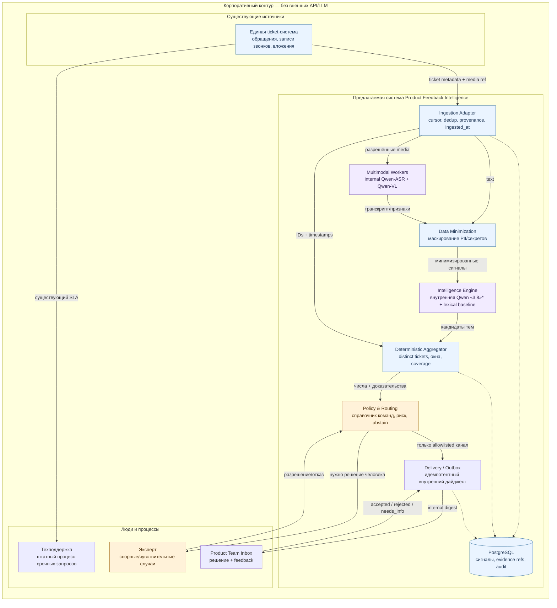
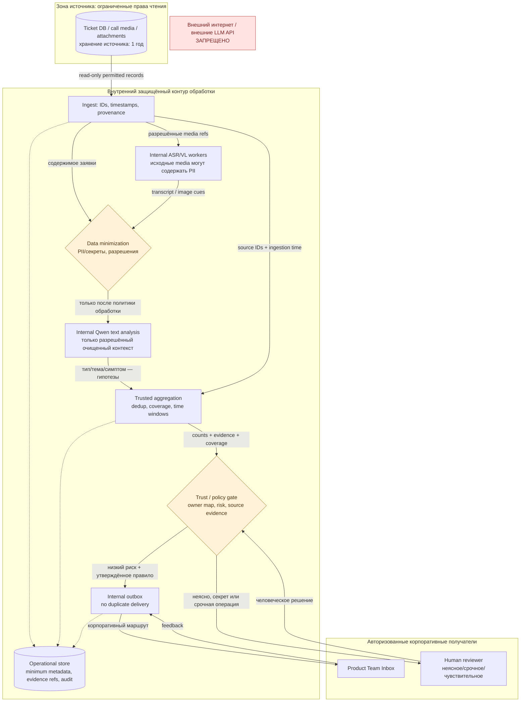
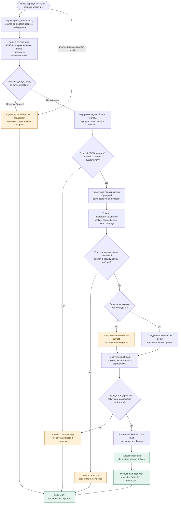

# Webneft V2 — diagrams (GitHub Mermaid preview)

**Project-only draft** for Intelligence Cup 2026, approved conceptual approach C (Hybrid). These diagrams **do not** describe actually deployed Webneft microservices or interfaces. Source of truth for competition rules: 7-page PDF `Кейс_Искусственный интеллект.pdf`. No external LLM/API. The exact text model version called «Qwen 3.8» in the PDF remains unverified.

**How to use:** the Mermaid source files next to this page are canonical; GitHub renders the fenced code blocks below, but rendered layout, Cyrillic text and export must still be visually checked before using in PowerPoint/PDF. For final slides, use a clean vector export and **do not** count linked docs as part of the 15k-character answer.

## 1. C4-inspired Container / логическая архитектура

[Editable source](./c4-containers.mmd)



## 2. Data Flow Diagram / ролевые границы и данные

[Editable source](./data-flow-trust-boundaries.mmd)



## 3. AI Agent Workflow / условные решения

[Editable source](./agent-workflow.mmd)



## 4. Feedback Sequence / передача продуктовой команде

[Editable source](./feedback-sequence.mmd)

```mermaid
%% Sequence: a candidate insight is NOT a confirmed technical incident.
sequenceDiagram
  autonumber
  participant S as Ticket System
  participant I as Ingestor
  participant M as Internal Qwen ASR/VL/Text
  participant A as Trusted Aggregator
  participant P as Policy & Routing
  participant O as Internal Outbox
  participant T as Product Team
  participant H as Human Reviewer
  S-->>I: read-only ticket/call refs
  I->>I: capture source_created_at / ingested_at
  opt permitted audio / image
    I->>M: internal-only media processing (restricted PII boundary)
  end
  I->>M: minimized text / approved signals
  M-->>A: proposed intent, topic, symptom; not a diagnosis
  I->>A: authoritative source IDs + timestamps
  A->>A: distinct count, time window, coverage
  A-->>P: evidence-linked unverified candidate
  alt urgent, sensitive, incomplete or no routing
    P->>H: route to existing human process
    H-->>P: decision / need more evidence
  else policy allows advisory product digest
    P->>O: create digest with stable idempotency key
    O->>T: approved internal channel (no external API)
    T-->>O: ack + accepted / rejected / needs_info
    O-->>A: feedback for evaluation and KPIs
  end
  Note over A,T: Same business topic ≠ same technical incident
  Note over S,T: No actual company API, time-to-insight or LLM quality is claimed
```

## Review checklist

- [ ] All four Mermaid blocks **render successfully** in GitHub (the repo itself does not include a Mermaid renderer yet).
- [ ] Cyrillic and arrow labels are legible in 16:9 export.
- [ ] Raw media is handled exclusively within the corporate boundary (it may carry PII before ASR/VL).
- [ ] No network link into external-API/LLM blocked entity.
- [ ] Urgent support remains on its existing SLA independent of AI.
- [ ] Unknown source coverage allows an observed lower bound, **not** a complete count/growth claim.
- [ ] Team routing comes from enterprise registry, not model inference.
- [ ] Feedback loops into evaluation, not into an automatic issue declaration.

Referenced in [architecture document](../architecture/webneft-v2-architecture.md), [Superpowers spec](../superpowers/specs/2026-10-31-webneft-evidence-first-agent-design.md) and [agent tool contracts](../agent/tool-contracts.md).
